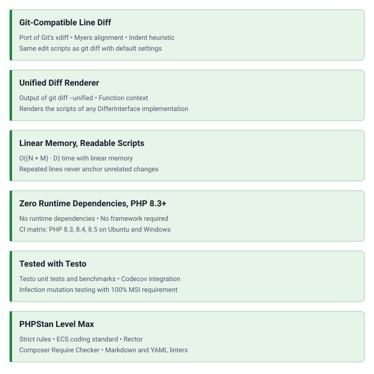

<!-- markdownlint-disable MD041 -->
<p align="center">
    <a href="https://github.com/php-forge/diff" target="_blank">
      
    </a>
    <h1 align="center">Diff</h1>
    <br>
</p>
<!-- markdownlint-enable MD041 -->

<p align="center">
    <a href="https://github.com/php-forge/diff/actions/workflows/build.yml" target="_blank">
        
    </a>
    <a href="https://dashboard.stryker-mutator.io/reports/github.com/php-forge/diff/main" target="_blank">
        
    </a>
    <a href="https://github.com/php-forge/diff/actions/workflows/static.yml" target="_blank">
        
    </a>
    <a href="https://github.com/php-forge/diff/actions/workflows/security.yml" target="_blank">
        
    </a>
</p>

<p align="center">
    <strong>Git-compatible line diff for PHP</strong><br>
    <em>A port of Git's default diff, indent heuristic included, plus a unified diff renderer, with no runtime dependencies.</em>
</p>

## Features

<picture>
    <source media="(min-width: 768px)" srcset="./docs/svgs/features.svg">
    
</picture>

## Installation

```bash
composer require php-forge/diff:^0.1
```

## Quick start

`LineDiffer` implements `PHPForge\Diff\DifferInterface`. `diff()` splits both strings on `"\n"` and returns an ordered
list of `DiffLine` objects, each tagged with a `DiffOp`:

- `DiffOp::Remove`: the line exists only in `$old`.
- `DiffOp::Add`: the line exists only in `$new`.
- `DiffOp::Context`: the line exists on both sides.

Every input line appears exactly once, so dropping the `Add` lines reconstructs `$old` and dropping the `Remove` lines
reconstructs `$new`.

```php
use PHPForge\Diff\{DiffOp, LineDiffer};

$old = "apple\nbanana\ncherry";
$new = "apple\nblueberry\ncherry";

foreach ((new LineDiffer())->diff($old, $new) as $line) {
    echo match ($line->op) {
        DiffOp::Context => ' ',
        DiffOp::Remove => '-',
        DiffOp::Add => '+',
    } . $line->line . "\n";
}
```

```text
 apple
-banana
+blueberry
 cherry
```

`UnifiedDiffRenderer` turns two texts into a unified diff in Git's format, hunk headers and function context included,
without the `diff --git` and `index` lines.

```php
use PHPForge\Diff\UnifiedDiffRenderer;

$old = "apple\nbanana\ncherry\n";
$new = "apple\nblueberry\ncherry\n";

echo (new UnifiedDiffRenderer())->render($old, $new, 'a/fruit.txt', 'b/fruit.txt');
```

```text
--- a/fruit.txt
+++ b/fruit.txt
@@ -1,3 +1,3 @@
 apple
-banana
+blueberry
 cherry
```

## What you get

| Class                 | Result                                                      | Cost                                         |
| --------------------- | ----------------------------------------------------------- | -------------------------------------------- |
| `LineDiffer`          | The edit script of `git diff` with its default settings     | O((N + M) · D) time, linear memory           |
| `UnifiedDiffRenderer` | The text of `git diff --unified=<n>` from the `---` line on | The injected differ plus one pass over edits |

N and M are the line counts of `$old` and `$new`, and D is the edit distance. Like Git, `LineDiffer` favours readable
scripts over the shortest one, so its edit count is not always minimal. Unlike Git, it has no cost limit, so on very
expensive inputs its script can differ from Git's. See the [algorithms guide](docs/algorithms.md) for the pipeline and
its trade-offs.

## Documentation

- 📚 [Installation guide](docs/installation.md)
- 🧮 [Algorithms guide](docs/algorithms.md)
- 💡 [Usage examples](docs/examples.md)
- 🧪 [Testing guide](docs/testing.md)
- 🤖 [AI assistance](docs/agents.md)

## AI assistance

AI agents: read the [documentation index](https://yii2-framework.github.io/docs/llms.txt) and fetch the Markdown version
of a page by appending `index.md` to its URL. The
[AI agents guide](https://yii2-framework.github.io/docs/project/ai-agents/) covers skill installation, client setup and
verification.

- 🤖 [`php-forge-diff` skill](docs/agents.md): Line edit scripts and unified diffs.

If hosted documentation does not match the installed revision or is unavailable, use the
[repository guides](#documentation), the [skill source](skills/php-forge-diff/SKILL.md), the source PHPDoc and the
[changelog](CHANGELOG.md).

## Package information

[](https://www.php.net/releases/8.3/en.php)
[](https://packagist.org/packages/php-forge/diff)
[](https://packagist.org/packages/php-forge/diff)

## Project status

[](https://codecov.io/github/php-forge/diff)
[](https://github.com/php-forge/diff/actions/workflows/static.yml)
[](https://github.com/php-forge/diff/actions/workflows/quality.yml)

## Built with AI

[](https://claude.com/claude-code)
[](https://openai.com/codex)
[](https://www.coderabbit.ai)

## Our social networks

[](https://x.com/Terabytesoftw)
[](https://www.facebook.com/wilmer.arambula.9)

## License

[](LICENSE)
